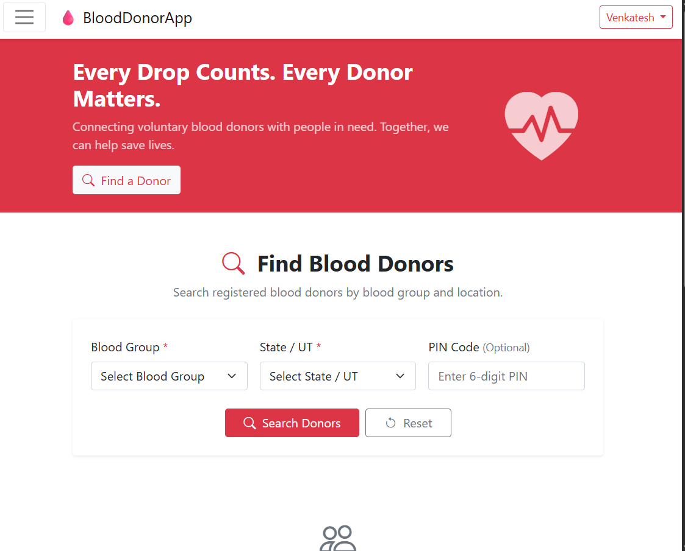
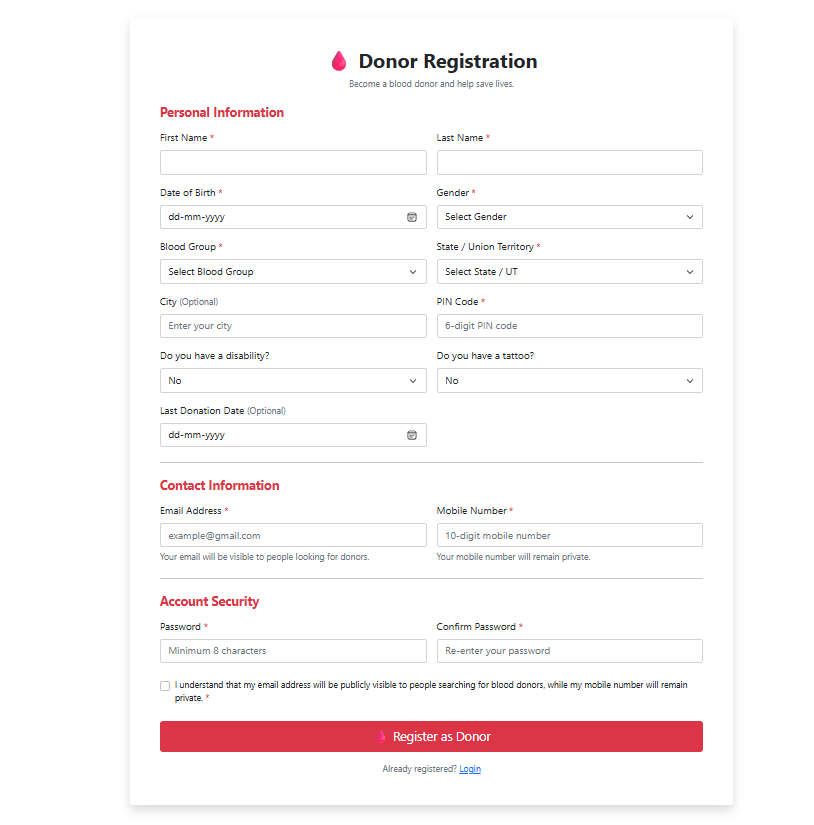
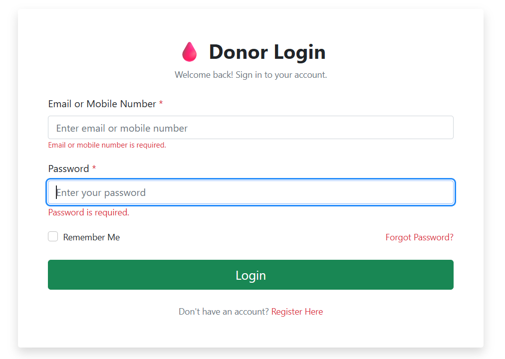
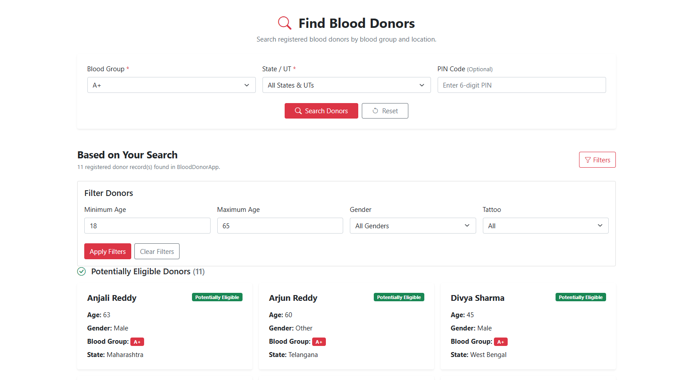
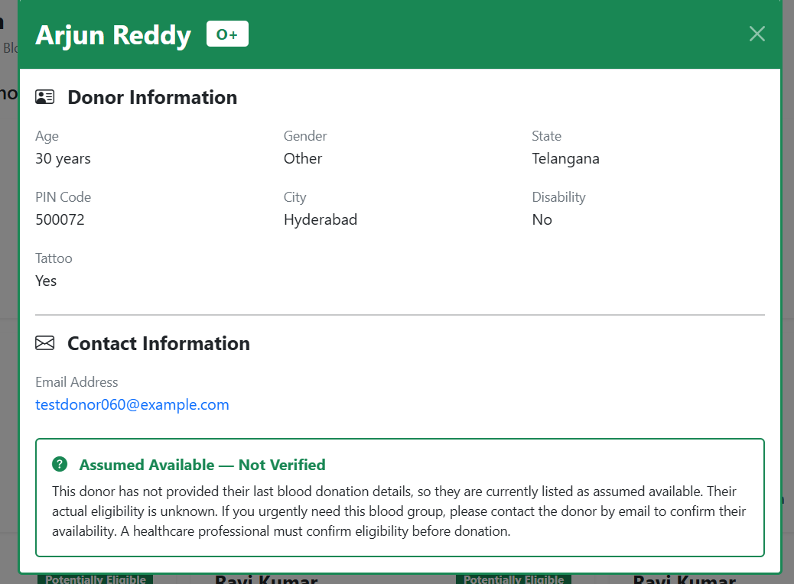
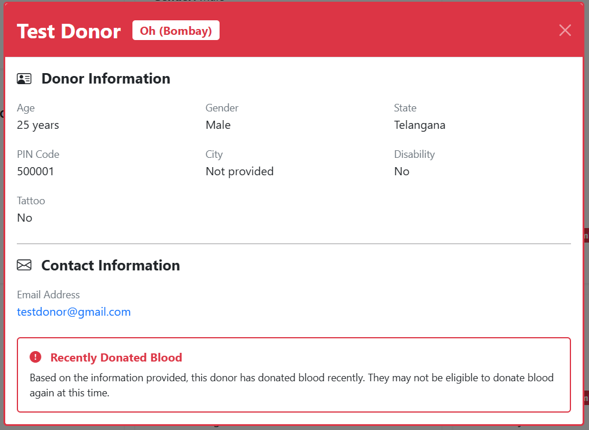
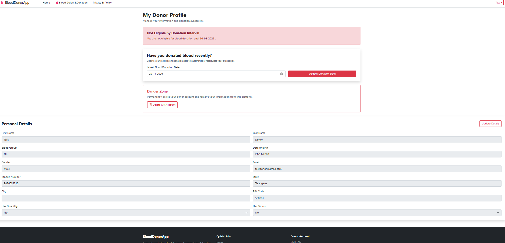
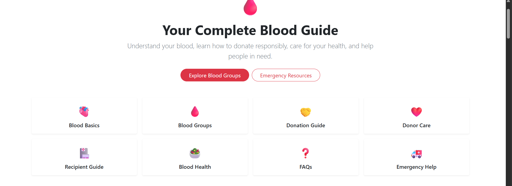

# BloodDonorApp — Blood Donor Management System

A local demonstration application built with **ASP.NET Core MVC (.NET 8)**, **C#**, **SQL Server**, **Entity Framework Core**, and **Bootstrap 5**. BloodDonorApp allows donors to register and manage their profiles, while visitors can search registered donor records by blood group and location and contact donors by email.

> **Project status:** Portfolio/demo application. Not a verified donor registry, clinical eligibility service, or production emergency-response platform. The screenshots use demonstration records.

## Application preview



| Registration | Donor login |
|---|---|
|  |  |

### Search and donor details



| Assumed available — unverified | Recently donated |
|---|---|
|  |  |

### Donor profile and educational guide





## Features

- Donor registration, login, logout, and profile management.
- Passwords stored as hashes using ASP.NET Core `PasswordHasher<Donor>`; cookie-based authentication.
- Mobile number restricted from public donor results and displayed to the donor in their profile; currently not editable through the profile interface.
- Public donor search by blood group, state/UT, and optional six-digit PIN code.
- Advanced filters for age range, gender, and tattoo status.
- Clickable donor result cards opening a Bootstrap modal with donor information and an email `mailto:` link.
- Donation-status presentation based on the last **self-reported** donation date; missing dates are marked **assumed available — not verified**.
- Educational blood donation guide and privacy information.
- Support for the `Oh (Bombay)` blood group.

## Technology

| Layer | Technology |
|---|---|
| Application | ASP.NET Core MVC, .NET 8, C# |
| UI | Razor views, HTML, Bootstrap 5, JavaScript |
| Database | Microsoft SQL Server |
| Data access | Entity Framework Core |
| Authentication | ASP.NET Core cookie authentication and `PasswordHasher<Donor>` |
| Development | Visual Studio 2022 |

## Project structure

```text
BloodDonorApp/
├── Controllers/       # MVC endpoints and actions
├── Models/            # Database entities
├── ViewModels/        # Search and display models
├── Views/             # Razor UI
├── Data/              # DbContext and related data code
├── Migrations/        # EF Core schema migrations
├── Services/          # PIN-code validation service
├── wwwroot/           # Static assets
├── Program.cs         # Dependency injection and request pipeline
└── docs/screenshots/  # README images (add this documentation folder)
```

## Run locally

1. Install **Visual Studio 2022** with the ASP.NET and web development workload, **.NET 8 SDK**, and **SQL Server Express** (or another SQL Server instance).
2. Clone the repository and open the solution in Visual Studio.
3. Configure `ConnectionStrings:DefaultConnection` in your local configuration for your SQL Server instance. Never commit database credentials.
4. Restore NuGet packages and build the solution.
5. Open **Tools → NuGet Package Manager → Package Manager Console** and run `Update-Database` with BloodDonorApp selected as the default project.
6. Run the application using HTTPS, register a fictional donor account, and test login, search, filters, and the details modal.

**Note:** The 100 fictional records used in the screenshots live in the developer's local database; a fresh clone does not automatically include them.

## Demonstration data

The developer's local database includes approximately 100 **fictional donor records** for UI and search testing. They are not real donors, and their email addresses are not valid emergency contacts. Database contents are not automatically included with the source repository. Avoid uploading real donor information or local database backups.

## Limitations and responsible use

- Donor details are self-reported; availability and medical eligibility **must be independently confirmed** by an appropriate medical professional or blood bank.
- A missing donation date does **not** establish eligibility, even if the interface colors that record green.
- The application is not suitable for real emergency matching or production deployment without additional security, privacy, consent, verification, and operational safeguards.
- The current password-recovery approach based on matching email and mobile number does **not** verify account ownership. Replace it with verified, expiring email reset links before any public deployment.
- Publicly displayed email addresses and sensitive donor details require informed consent and suitable privacy controls before real-world use.
- PIN-code validation relies on an external postal-data service and may be unavailable.

## Roadmap (not implemented)

Verified email recovery; explicit public-profile consent; donor-controlled availability; verified contact methods; operational moderation and audit logging.

## Release

**v1.0.0 (planned)** — local portfolio demonstration. Production deployment requires additional security, privacy, and verification work.
